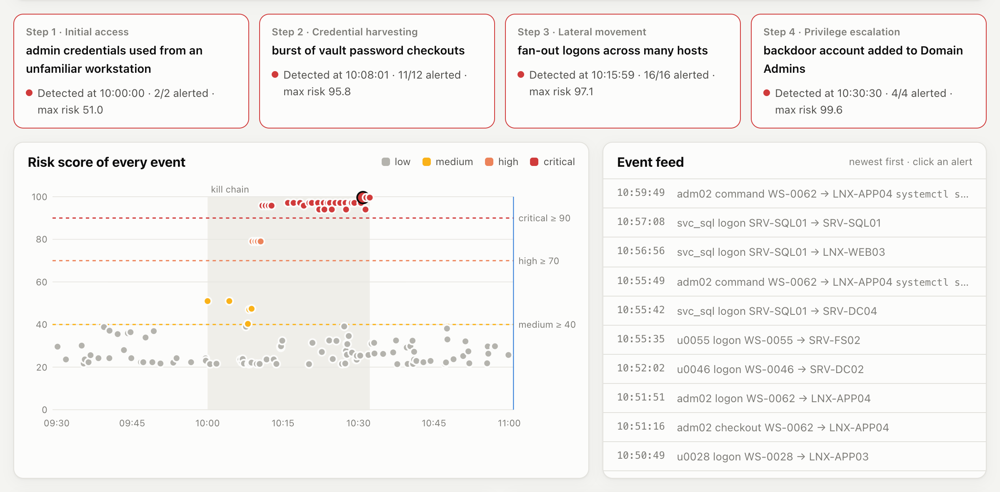
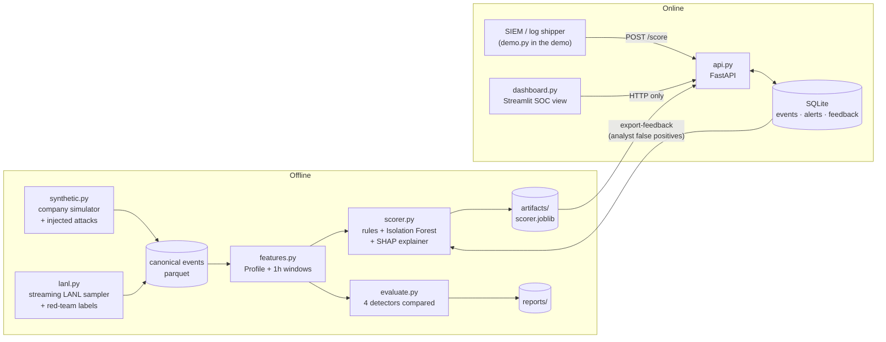
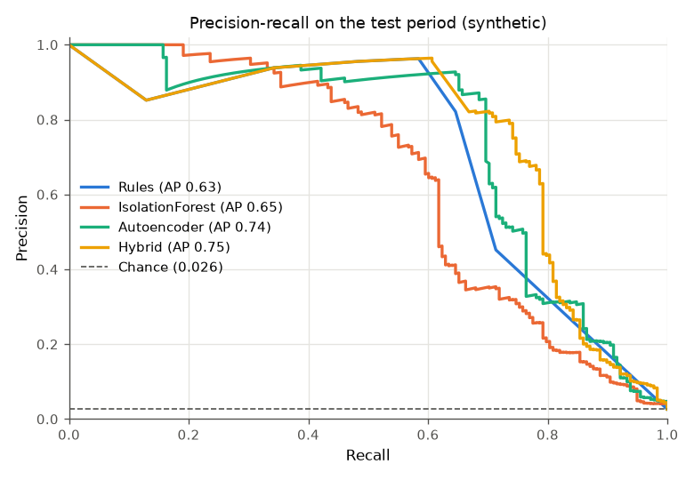
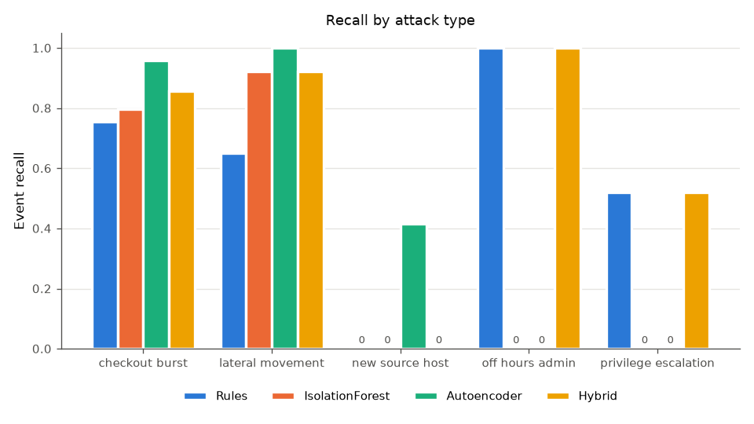
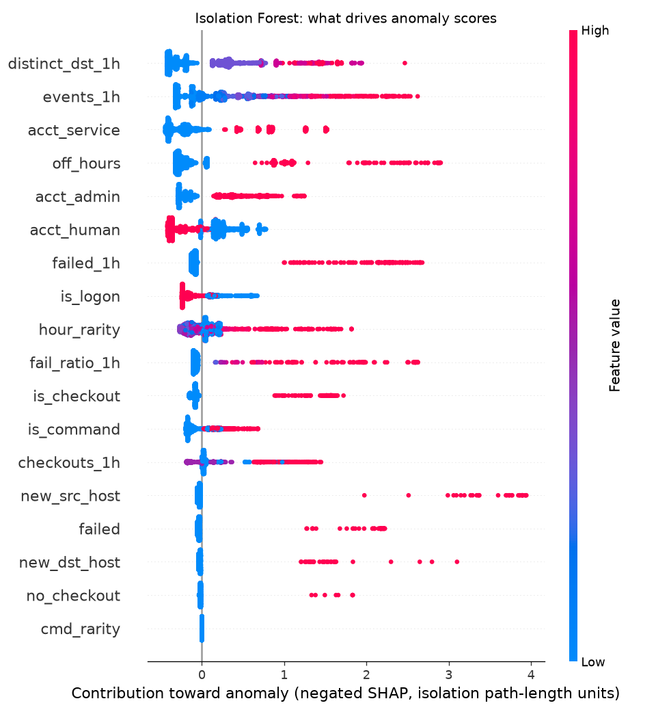
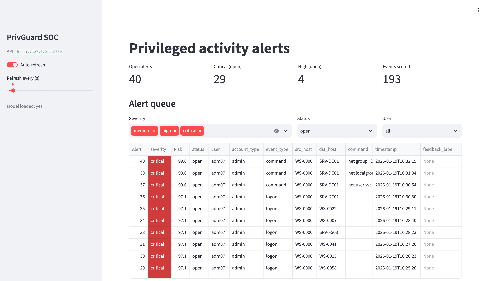
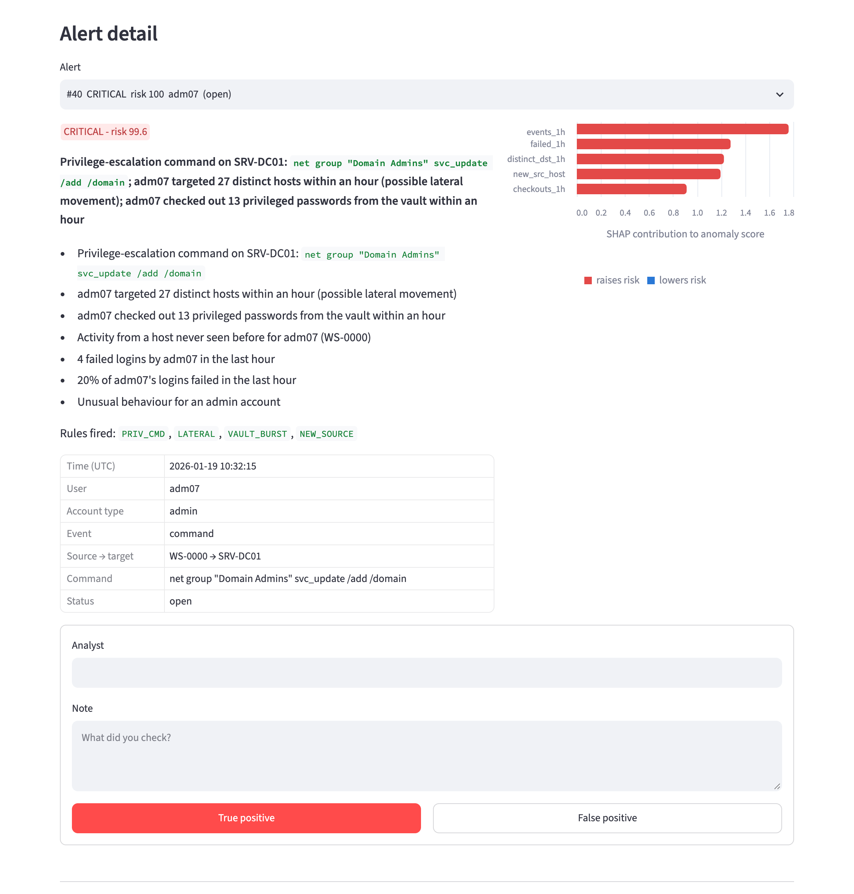
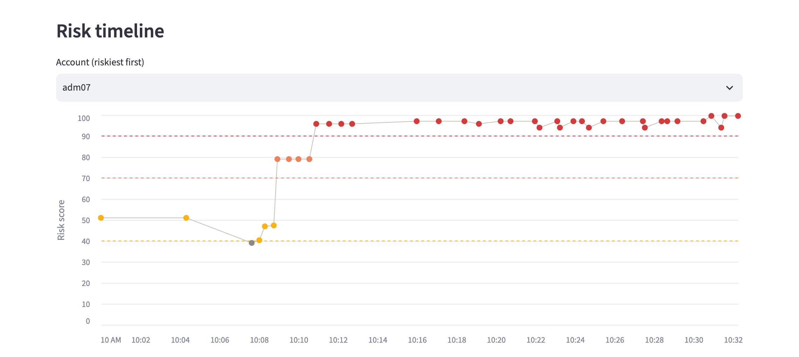
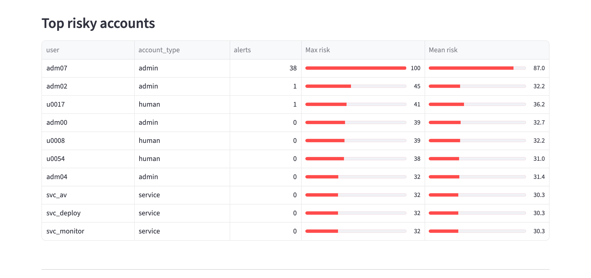
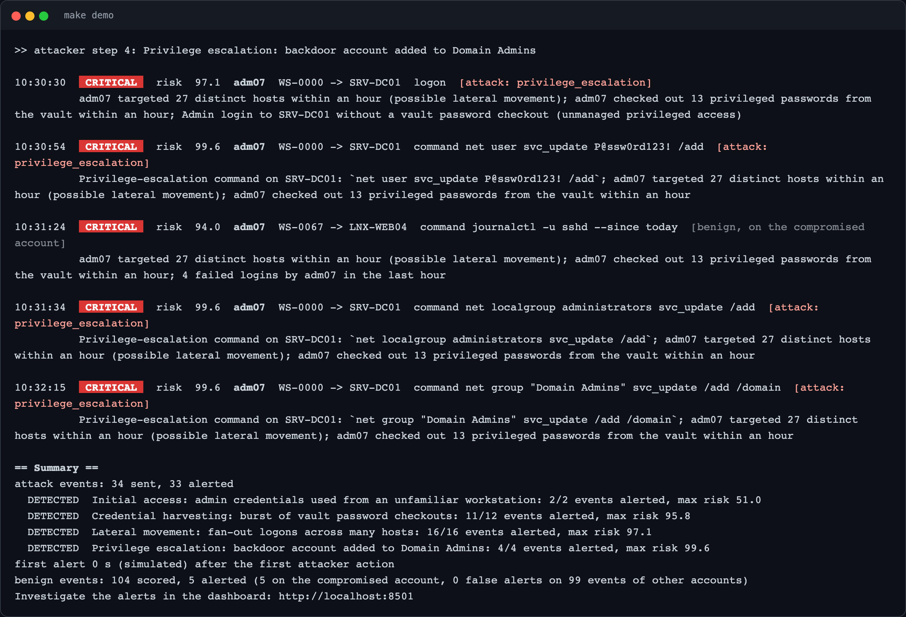

<div align="center">

# 🛡️ PrivGuard

**ML-based privileged-activity anomaly detection, inspired by CyberArk Privileged Threat Analytics (PTA).**

[](https://github.com/Harshitraiii2005/Privileged-Activity-Anomaly-Detector-PTA-style-/actions/workflows/ci.yml)
[](https://harshitraiii2005.github.io/Privileged-Activity-Anomaly-Detector-PTA-style-/)


### [▶ Live demo: watch an attack get caught](https://harshitraiii2005.github.io/Privileged-Activity-Anomaly-Detector-PTA-style-/)

</div>

PrivGuard analyzes authentication, vault-checkout and privileged-session logs, scores every event against the
account's own baseline, and raises alerts with a plain-English explanation of why.

[](https://harshitraiii2005.github.io/Privileged-Activity-Anomaly-Detector-PTA-style-/)
<sub>The [showcase site](https://harshitraiii2005.github.io/Privileged-Activity-Anomaly-Detector-PTA-style-/) replays
a compromised admin's four-step kill chain hidden in 90 minutes of company traffic. Every score and explanation is the trained
model's real output: all 4 steps are detected, with 0 false alerts on other accounts.</sub>

### Highlights

| | |
|---|---|
| 🎯 **Detection** | Hybrid rules + Isolation Forest: **0.79 recall, 0.75 PR-AUC**, 13/17 attack incidents on a 14-day test period, with label-free thresholds |
| 💬 **Explainability** | Every alert gets a one-sentence reason from SHAP + rules, e.g. *"Admin activity at 01:49, outside business hours… Admin login to LNX-WEB04 without a vault password checkout"* |
| 🔐 **PAM-native signals** | Vault checkouts, PSM-style session commands, unmanaged privileged access, irregular hours and hosts |
| ⚙️ **Production shape** | FastAPI + SQLite, a Streamlit SOC dashboard with analyst feedback, Docker Compose, CI with a coverage gate, `make demo` |

## Contents
[Problem](#problem-statement) · [Quickstart](#quickstart) · [Architecture](#architecture) · [Data](#data) ·
[Features](#features) · [Models](#models) · [Results](#results) · [Explainability](#explainability) ·
[API](#api) · [Dashboard](#soc-dashboard) · [Showcase site](#showcase-site) · [CyberArk mapping](#cyberark-mapping) ·
[Design decisions](#design-decisions) · [Limitations](#limitations) · [Future work](#future-work)

## Problem statement

Privileged accounts (domain admins, server admins, service accounts) are what attackers go after: whoever holds
them can reach anything. Static rules catch the patterns someone thought to write down, but miss behaviour that is
only abnormal *for that account*, such as an admin working at 03:00 or a user suddenly reaching 30 hosts.
A raw anomaly score is also useless to a SOC analyst unless it says *why*.

PrivGuard combines both approaches, the way PTA does. It runs PAM-style rules next to an unsupervised model that
learns each account's normal footprint, and it explains every alert in one sentence an analyst can act on.

## Quickstart

Requires Python 3.11. Docker is optional.

```bash
make install    # .venv with all extras (ml, api, dashboard, dev)
make demo       # synthetic data -> train -> API + dashboard -> live attack replay. No Docker needed
make evaluate   # metrics + plots for all detectors -> reports/synthetic/
make test       # pytest + coverage
make up         # docker compose: API on :8000, dashboard on :8501
```

`make demo` starts the API and the dashboard in the background, replays the attack at 120x speed (about 45 s),
prints a live feed and a detection summary, then keeps the dashboard at <http://localhost:8501> open until you press Enter.
Use `make demo DEMO_ARGS="--speed 0"` to replay without pauses.

| Command | What it does |
|---|---|
| `make data` | Generate `data/processed/synthetic_events.parquet` (seeded, about 2 s) |
| `make train` | Train the served scorer → `artifacts/scorer.joblib` (`make -B train` forces a retrain) |
| `make evaluate` | Train rules / Isolation Forest / autoencoder / hybrid on the baseline, evaluate on the attack period |
| `make api` / `make dashboard` | Run the FastAPI service (:8000) / Streamlit dashboard (:8501) locally |
| `make lanl` | Build a labeled sample from the LANL dataset (see [Data](#lanl-real-world)) |
| `make demo-docker` | The demo against the compose stack |
| `make site` | Build the static showcase into `site/` (preview: `python -m http.server -d site 8080`) |
| `make lint` / `make clean` | ruff / remove generated data, models and caches |

## Architecture



What happens on `POST /score`:
1. Pydantic validates the events (enums, non-empty names, 1–10,000 per request).
2. The API loads the past hour of those users' events from SQLite as history.
3. `build_features(events, profile, history)` runs, the same call used in training.
4. The rules and the Isolation Forest score each event, and the scores are calibrated into a 0–100 risk.
5. SHAP explains the events that alert.
6. Events, scores and alerts are written to SQLite in one transaction.

## Data

Every source is converted to one canonical event schema ([schema.py](src/privguard/schema.py)), so features, models
and the API never care where an event came from.

| Column | Meaning |
|---|---|
| `timestamp` | event time |
| `user` | account performing the action |
| `account_type` | `human`, `admin` or `service` |
| `src_host` / `dst_host` | origin and target host (for `checkout`: the host whose credential was retrieved) |
| `event_type` | `logon`, `command` (privileged-session command) or `checkout` (password retrieved from the vault) |
| `success` | authentication outcome |
| `command` | command line, for `command` events |
| `is_attack` / `attack_type` | ground-truth label and scenario name (evaluation only; never sent to the API) |

Data is never committed (`data/` is git-ignored). All settings live in [config.toml](config.toml).

### Synthetic company (default)

`make data` simulates a small company (60 employees, 8 IT admins, 6 service accounts, 68 workstations,
20 Windows/Linux servers) for 28 days. Days 0–13 are a clean baseline; attacks are injected from day 14.

| Attack | What is injected | Primary signal | Benign look-alike that makes it non-trivial |
|---|---|---|---|
| `off_hours_admin` | Admin session at 01:00–04:30 with no vault checkout | login hour, no checkout | on-call admin sessions 19:00–05:00; service accounts run 24/7 |
| `new_source_host` | 2–4 logons from a workstation the account has never used | new source host | hot-desking: about 2% of employee days start at another workstation |
| `lateral_movement` | One account hits 15–40 distinct hosts in about an hour, about 30% of logons fail | distinct hosts per hour, failures | mistyped passwords (about 3% of logons) |
| `checkout_burst` | 10–25 vault password checkouts within minutes | checkouts per window | admins check out a password before about 90% of sessions |
| `privilege_escalation` | `net user X /add`, `net group "Domain Admins" X /add`, `sudo su -`, sudoers edit, at normal hours from the normal host | rare command | benign `net user jdoe /domain`, `net localgroup administrators`, `sudo systemctl restart nginx` |

With the default seed this yields 13,050 events, 178 of them attack events (1.36%), from 18 injected incidents.
The evaluation counts 17 incidents because it groups by (user, attack type), and one admin drew two off-hours incidents.

### LANL (real-world)

The [LANL "Comprehensive, Multi-Source Cyber-Security Events"](https://csr.lanl.gov/data/cyber1/) dataset is
58 consecutive days of de-identified enterprise events with red-team ground truth.

1. Open <https://csr.lanl.gov/data/cyber1/> and fill in the short form (email + intended use) to download.
2. Download **`auth.txt.gz`** (~7.2 GB) and **`redteam.txt.gz`** (~4.8 KB). Do not decompress them.
3. Place them in `data/raw/lanl/`:
   ```bash
   mkdir -p data/raw/lanl
   mv ~/Downloads/auth.txt.gz ~/Downloads/redteam.txt.gz data/raw/lanl/
   ```
4. `make lanl` builds `data/processed/lanl_events.parquet`. Then run `.venv/bin/python -m privguard.evaluate --dataset lanl`.

The full file is too big to load, so [lanl.py](src/privguard/lanl.py) streams it in chunks. It keeps:
- events inside the `[lanl] start_time..end_time` window (default: the first 10 days). The file is time-ordered, so reading stops at the end of the window;
- every red-team user, plus a deterministic `user_sample_rate` fraction of the other users (a crc32 hash of the user name, so the sample is the same on every run and each user's history stays whole);
- all orientations except `LogOff`.

Red-team rows are joined back onto auth events by `(time, user, source host, destination host)` to label `is_attack`.
For LANL, the train/test boundary is the first red-team event. Labels only place that boundary; they never enter features or training.

**LANL limitations:**
- No role data: accounts matching `U<n>@` map to `human`, everything else to `service`, and nothing is `admin`.
- No commands and no vault checkouts.
- Timestamps are seconds from an undisclosed start, so hour-of-day is relative.

LANL therefore exercises the logon-based detectors only. **No LANL results are reported here.** The 7.2 GB file was
not downloaded for this build, and this README only reports numbers the code produced.

Citation: A. D. Kent, "Comprehensive, Multi-Source Cybersecurity Events," Los Alamos National Laboratory,
<http://dx.doi.org/10.17021/1179829>, 2015. CC0.

## Features

Every event gets an 18-value feature vector from [features.py](src/privguard/features.py), built from two kinds of context:
- a **Profile** learned on the clean baseline: which hosts each account uses, when it is active, and which command tokens admins type;
- **trailing 1-hour windows** over the same account's recent events.

The same `build_features()` call runs in training, evaluation and the live API, so there is no train/serve skew.
Windows are causal: they only see events at or before the one being scored.

| Feature | Definition | Security reason | Main target |
|---|---|---|---|
| `off_hours` | 1 if outside 07:00–19:59 or on a weekend | Attackers act when nobody is watching | off-hours admin |
| `hour_rarity` | 1 − (account's baseline activity within ±1 h of this hour ÷ its busiest hour); unseen account = 1 | Personal baseline: 03:00 is normal for `svc_backup`, not for `adm03`, so nightly jobs don't raise alerts | off-hours admin |
| `new_src_host` | (account, source host) never seen in baseline | Stolen credentials get used from the attacker's foothold, not the owner's machine | new source host |
| `new_dst_host` | (account, target host) never seen in baseline | Touching systems outside the account's normal scope is the first sign of lateral movement or recon | lateral movement, checkout burst |
| `distinct_dst_1h` | distinct target hosts for this account in the last hour | Fan-out to many hosts in a short time is the shape of lateral movement | lateral movement |
| `events_1h` | events for this account in the last hour | Activity burst; context for the ratios | several |
| `fail_ratio_1h` | failed ÷ attempted logons in the last hour | Password guessing, stale or sprayed credentials | lateral movement |
| `failed_1h` | failed logons in the last hour | Absolute failure volume, so one typo (50% of 2 attempts) is not a burst | lateral movement |
| `checkouts_1h` | vault password retrievals in the last hour | Bulk credential harvesting from the vault | checkout burst |
| `cmd_rarity` | share of the command's tokens never typed in baseline | New commands in a privileged session (user creation, group changes). This is token novelty, not a keyword blacklist, so the benign `net user jdoe /domain` scores 0 | privilege escalation |
| `no_checkout` | admin remote logon with no vault checkout of that host in the prior 15 min | A privileged credential used without being retrieved from the vault was probably stolen or cached | off-hours admin |
| `failed` | this event is a failed logon | Raw failure signal | lateral movement |
| `acct_human/admin/service` | one-hot account type | The same behaviour carries different risk for a person, an admin or a service account | all |
| `is_logon/command/checkout` | one-hot event type | Gives context: `cmd_rarity` only means something for commands | all |

`python -m privguard.features` prints the mean of each feature by group over the test period (real output, default seed):

| Feature | benign | checkout_burst | lateral_movement | new_source_host | off_hours_admin | privilege_escalation |
|---|---|---|---|---|---|---|
| off_hours | 0.15 | 0.00 | 0.70 | 0.00 | 1.00 | 0.28 |
| hour_rarity | 0.26 | 0.31 | 0.81 | 0.31 | 1.00 | 0.08 |
| new_src_host | 0.01 | 0.00 | 0.00 | 1.00 | 0.00 | 0.00 |
| new_dst_host | 0.00 | 0.78 | 0.97 | 0.00 | 0.00 | 0.00 |
| distinct_dst_1h | 1.60 | 9.18 | 14.23 | 1.75 | 1.00 | 1.36 |
| events_1h | 3.42 | 9.18 | 14.23 | 2.75 | 2.60 | 6.92 |
| fail_ratio_1h | 0.03 | 0.00 | 0.24 | 0.00 | 0.00 | 0.00 |
| failed_1h | 0.06 | 0.00 | 3.73 | 0.00 | 0.00 | 0.00 |
| checkouts_1h | 0.45 | 8.88 | 0.00 | 0.00 | 0.00 | 1.56 |
| cmd_rarity | 0.00 | 0.00 | 0.00 | 0.00 | 0.00 | 0.33 |
| no_checkout | 0.01 | 0.00 | 0.00 | 0.00 | 0.27 | 0.00 |
| failed | 0.02 | 0.00 | 0.29 | 0.00 | 0.00 | 0.00 |

Each attack lights up the feature it was designed around. Benign means stay low but non-zero (hot-desking, on-call work, typos),
and that residue is where false positives come from. `cmd_rarity` averages only 0.33 for privilege escalation for two reasons.
The session's checkout, logon and one benign command all score 0. And escalation commands reuse known tokens:
`net localgroup administrators X /add` scores 2/5 because only `X` and `/add` are new.

## Models

All detectors live in [detectors.py](src/privguard/detectors.py). They train on the clean baseline only and set their
alert thresholds **without labels**.

| Detector | How it scores | Alert threshold |
|---|---|---|
| **Rules engine** | 7 PTA-style rules, combined as `1 − ∏(1 − wᵢ)` over the rules that fire | combined weight ≥ 0.4 |
| **Isolation Forest** | `−score_samples` (200 trees) on the 18 features | 99th percentile of its own baseline scores (about 1% baseline FPR) |
| **Autoencoder** | PyTorch MLP (18→16→8→16→18), reconstruction MSE on standardized features | 99th percentile of baseline reconstruction error |
| **Hybrid (served)** | `risk = max(rules risk, Isolation Forest risk)`, each mapped to 0–100 | risk ≥ 40 (`medium`) |

| Rule | Fires when | Weight |
|---|---|---|
| `PRIV_CMD` | command matches user creation, adding to administrators / Domain Admins, `sudo su`/`sudo -i`, `useradd`, `usermod -aG sudo\|wheel`, sudoers edit | 0.9 |
| `LATERAL` | ≥ 10 distinct target hosts in 1 h | 0.8 |
| `VAULT_BURST` | ≥ 5 vault checkouts in 1 h | 0.7 |
| `OFF_HOURS_PRIV` | admin, off hours, and `hour_rarity` ≥ 0.9 | 0.5 |
| `FAILED_BURST` | ≥ 5 failed logons in 1 h | 0.5 |
| `UNMANAGED_ACCESS` | admin remote logon with no vault checkout in the prior 15 min | 0.3 |
| `NEW_SOURCE` | new source host for a non-service account | 0.3 |

**Risk calibration** ([scorer.py](src/privguard/scorer.py)):
`risk = max(interp(r, [0, 0.4, 1], [0, 40, 100]), interp(s, [0, t_IF, 1], [0, 40, 100]))`, where `r` is the rules score,
`s` the Isolation Forest score and `t_IF` its baseline threshold. The mapping is monotonic, and *either detector's own
threshold lands exactly on the `medium` boundary*, so "alert" means the same thing for every component. Weak rules
(0.3) are context and only alert in combination. Severity bands: ≥ 90 critical, ≥ 70 high, ≥ 40 medium.

The autoencoder is used for evaluation only. Serving uses rules + Isolation Forest, so the API image needs no PyTorch
and the Isolation Forest supports exact TreeSHAP.

## Results

`make evaluate` on the synthetic dataset. The train set is the clean baseline: 6,276 events before 2026-01-19.
The test set is 6,774 events over 14 days, with 178 attack events from 17 incidents. All numbers are event-level unless
marked otherwise and are copied from [reports/synthetic/metrics.md](reports/synthetic/metrics.md).

| Detector | Precision | Recall | F1 | PR-AUC | FPR | Incident recall | Benign alerts/day |
|---|---|---|---|---|---|---|---|
| Rules | **0.821** | 0.646 | **0.723** | 0.631 | **0.38%** | **0.76 (13/17)** | **1.8** |
| Isolation Forest | 0.512 | 0.618 | 0.560 | 0.646 | 1.59% | 0.35 (6/17) | 7.5 |
| Autoencoder | 0.529 | 0.725 | 0.611 | 0.736 | 1.74% | 0.59 (10/17) | 8.2 |
| **Hybrid (served)** | 0.522 | **0.792** | 0.629 | **0.748** | 1.96% | **0.76 (13/17)** | 9.2 |

PR-AUC of a random scorer is 0.026 (the attack base rate in the test period).

Recall by attack type: event recall (incidents detected / incidents).

| Attack type | Rules | Isolation Forest | Autoencoder | Hybrid |
|---|---|---|---|---|
| `checkout_burst` | 0.76 (3/3) | 0.80 (3/3) | 0.96 (3/3) | 0.86 (3/3) |
| `lateral_movement` | 0.65 (3/3) | 0.92 (3/3) | 1.00 (3/3) | 0.92 (3/3) |
| `new_source_host` | 0.00 (0/4) | 0.00 (0/4) | 0.42 (4/4) | 0.00 (0/4) |
| `off_hours_admin` | 1.00 (3/3) | 0.00 (0/3) | 0.00 (0/3) | 1.00 (3/3) |
| `privilege_escalation` | 0.52 (4/4) | 0.00 (0/4) | 0.00 (0/4) | 0.52 (4/4) |

| Precision-recall | Recall by attack type |
|---|---|
|  |  |

**How to read this:**
- **Rules win on precision and analyst workload, but the comparison is rigged in their favour.** They were written by
  someone who knew the attack catalog. Against techniques nobody wrote a rule for, rules-only recall would be lower.
  The ML detectors never see labels.
- **ML adds recall on volume-shaped attacks.** Lateral movement event recall rises from 0.65 (rules) to 0.92 (hybrid),
  and checkout bursts from 0.76 to 0.86. The cost is about 7 extra benign alerts per day.
- **The detectors complement each other.** Rules catch off-hours admin and privilege escalation, which the Isolation
  Forest misses. The Isolation Forest catches the fan-out events that fall below rule thresholds. The hybrid has the best
  PR-AUC (0.748) and recall (0.792).
- **New source host is the hard case.** A single novelty signal sits inside benign hot-desking: 92 benign new-source
  events against 12 attack events in the test period. Only the autoencoder flags it (event recall 0.42), and it is not served.
- **The test set is small** (17 incidents), so a single incident moves incident recall by about 6 points.

**Fix found in review.** `FAILED_BURST` was first specified as "≥ 50% of logons failed and ≥ 5 events in the hour".
Because `events_1h` counts commands too, one mistyped password followed by three commands satisfied it. It now uses a
failed-logon count (`failed_1h ≥ 5`). Measured before → after: rules precision 0.692 → 0.821, FPR 0.79% → 0.38%,
benign alerts per day 3.7 → 1.8, recall 0.657 → 0.646. Hybrid FPR went from 2.46% to 1.96%.

**Live demo** (`make demo`, real output): a kill chain by one compromised admin is replayed with 104 benign events
around it. It goes new source host → 12 vault checkouts → 16 fan-out logons → backdoor account added to Domain Admins.
- 33/34 attack events alerted, and every step was detected.
- The first alert came 0 s (simulated) after the first attacker action.
- There were 0 false alerts on the 99 benign events of other accounts. The 5 benign alerts were on the compromised
  account itself, whose trailing-hour window is polluted by the attack.

## Explainability

[explain.py](src/privguard/explain.py) runs SHAP `TreeExplainer` on the Isolation Forest for every alert and turns
the top contributions into sentences, using one template per feature filled in with the event's own context
(time, user, hosts, command, counts). Reasons from fired rules come first. SHAP reasons are added only for features no
fired rule already explains. Features at value 0 are skipped, because an absence has no useful plain-English reading.

**SHAP sign convention, verified rather than assumed.** For an Isolation Forest, SHAP explains the expected path
length E[h(x)], and the check `expected_value + Σ shap = E[h(x)]` holds to 6.7e-16. A longer path means more
normal, so contributions are negated once. From then on, positive means "pushes toward anomaly".

Real explanations from the served model on test-period alerts:

| Attack | Risk | Explanation |
|---|---|---|
| off-hours admin | 65.0 medium | Admin activity at 01:49, outside business hours and at an hour adm07 is rarely active; Admin login to LNX-WEB04 without a vault password checkout (unmanaged privileged access) |
| privilege escalation | 90.0 critical | Privilege-escalation command on SRV-SQL03: `net user helpdesk2 P@ssw0rd123! /add`; 16 events by adm04 in the last hour; 3 vault password checkouts by adm04 in the last hour |
| lateral movement | 90.0 critical | u0039 targeted 30 distinct hosts within an hour (possible lateral movement); 9 failed logins by u0039 within the last hour (30% of attempts); First access by u0039 to WS-0051 |
| lateral movement (ML only, no rule) | 41.7 medium | First access by u0039 to WS-0036; 4 distinct hosts accessed by u0039 in the last hour; User login at 20:55, outside business hours |



## API

`uvicorn privguard.api:app` ([api.py](src/privguard/api.py)); interactive docs at `/docs`.

| Endpoint | Purpose |
|---|---|
| `GET /health` | `{"status": "ok", "model_loaded": bool}` |
| `POST /score` | `{"events": [...]}` → per event: `event_id`, `risk_score`, `severity`, `rules_triggered`, `reasons`, `explanation`, `top_features`, `alert_id` |
| `GET /alerts` | Alert queue, filterable by `status`, `severity`, `user` |
| `GET /alerts/{id}` | One alert with its full explanation |
| `POST /alerts/{id}/feedback` | `{"label": "true_positive" \| "false_positive", "analyst", "note"}`; closes the alert |
| `GET /events` | Scored events for a user's risk timeline |
| `GET /stats/top-users` · `GET /stats/summary` | Riskiest accounts · KPI counts |

```bash
curl -s localhost:8000/score -H 'content-type: application/json' -d '{"events": [{
  "timestamp": "2026-01-20T03:12:00", "user": "adm03", "account_type": "admin",
  "src_host": "WS-0099", "dst_host": "SRV-DC01", "event_type": "logon"}]}'
```

If no model is trained, the API still serves the triage endpoints and `/score` returns `503 model not trained`.
Analyst feedback closes the loop: `python -m privguard.store export-feedback` exports labeled alerts, and
`python -m privguard.scorer --feedback data/processed/feedback.parquet` retrains with the confirmed false positives
added to the baseline as normal behaviour.

## SOC dashboard

`streamlit run src/privguard/dashboard.py` ([dashboard.py](src/privguard/dashboard.py)) talks to the API over HTTP only. It has:
- a KPI row;
- an **alert queue** filtered by severity, status and user;
- **alert detail** with the explanation, fired rules, a SHAP bar chart and the event context;
- **true / false positive feedback** buttons;
- a **risk timeline per user** with the severity bands drawn in;
- the **top risky accounts**.

The overview auto-refreshes, so alerts appear live during `make demo`.

### Screenshots

Captured from a real `make demo` run.

**Alert queue with KPIs**


| Alert detail: explanation, SHAP contributions, analyst feedback | Risk timeline of the compromised admin |
|---|---|
|  |  <br>  |

**`make demo` terminal feed** (last attack step and summary)


## Showcase site

The [live demo](https://harshitraiii2005.github.io/Privileged-Activity-Anomaly-Detector-PTA-style-/) is a static page in
[site/](site/) (plain HTML/CSS/JS, no build step, light and dark themes, works on phones). Its content:
- an **interactive replay** of the `make demo` scenario, with a kill-chain tracker, a live risk timeline, an event feed, the alert queue, and alert detail with SHAP bars;
- the **results** table and recall-by-attack chart, read from `reports/synthetic/metrics.json`;
- the pipeline, the CyberArk mapping, and the dashboard screenshots.

Nothing on it is hand-written data. [export_site.py](src/privguard/export_site.py) scores the demo scenario with the
trained scorer. Features are causal and the profile is frozen, so the scores are identical to the live API's (both give
33/34 attack events alerted and 5 benign alerts). The [Pages workflow](.github/workflows/pages.yml) rebuilds everything
from the seed on every push to `main`: data → train → export → deploy.

## CyberArk mapping

PrivGuard is a learning project and is not affiliated with CyberArk. The table maps PAM concepts to their counterparts here.

| CyberArk concept | PrivGuard equivalent |
|---|---|
| **PTA behavioural profiling**: per-user normal hours and machines | `Profile`: `hour_rarity`, known (account, host) pairs |
| **PTA**: privileged access at irregular hours | `OFF_HOURS_PRIV` rule, `off_hours` / `hour_rarity` features |
| **PTA**: access from an irregular machine | `NEW_SOURCE` rule, `new_src_host` |
| **PTA**: privileged account used without being retrieved from the **Vault** (suspected credential theft / unmanaged access) | `UNMANAGED_ACCESS` rule, `no_checkout` |
| **PTA**: excessive retrieval of privileged credentials from the **Vault** | `VAULT_BURST` rule, `checkouts_1h` |
| **PTA**: risky commands in **PSM / PSMP** privileged sessions | `PRIV_CMD` rule, `cmd_rarity` on `command` events |
| **Vault** audit of password retrievals (PVWA show/copy/connect) | `checkout` events |
| **PSM** session command audit | `command` events, tied to the session's source and target |
| **PTA** security events with a risk score, triaged in the PVWA dashboard | `risk_score` 0–100 + severity, Streamlit alert queue |
| Analysts handling or closing security events | TP/FP feedback → retraining with confirmed false positives |
| PTA ingesting Vault / SIEM logs | `POST /score` REST ingestion |
| PTA automatic response (e.g. suspend a PSM session, rotate a credential) | Not implemented; see future work |
| PTA protocol-level detections (e.g. Kerberos ticket abuse from DC traffic) | Out of scope: no network or DC telemetry. `LATERAL` detects only the behavioural fan-out |

## Design decisions

These are the choices to be ready to defend:

1. **One canonical event schema.** LANL and the simulator look nothing alike. Each source gets one mapper, and nothing downstream changes.
2. **Clean baseline, then attacks.** "Never seen before" only means something against history, so the first 14 days are attack-free, as with PTA's learning period.
3. **Each attack has one primary signal plus a benign look-alike.** This shows which detector catches which technique, and keeps the false-positive rate realistic instead of near zero.
4. **Train/serve parity.** The same `build_features()` runs in training, evaluation and the API. The API rebuilds the trailing-hour context from SQLite history.
5. **Label-free thresholds.** ML thresholds are the 99th percentile of each model's own baseline scores. Labels are used only to evaluate.
6. **Profile on the first half of the baseline, models on the second half.** A profile fitted on the same events it featurizes makes every novelty feature constant 0, and an Isolation Forest can't split on a constant. This was found on training data, without labels. The served profile is then refitted on the full baseline.
7. **Hybrid served model with a shared calibration.** Rules give precision and readable reasons. ML covers what nobody wrote a rule for. Mapping each threshold to risk 40 makes the hybrid alert exactly when either part alerts.
8. **No PyTorch in serving.** The autoencoder ranks about as well as the Isolation Forest overall but is evaluation-only. That keeps gigabytes out of the image and keeps exact TreeSHAP.
9. **The dashboard goes through the API, never SQLite.** One contract, one validation layer, a separate container, and the same view any SOAR client would get.
10. **SQLite in WAL mode.** No server to run, and readers don't block the writer. This is fine for one API instance; see limitations.
11. **Deterministic everything.** A seeded generator, seeded models and a seeded demo, with tests asserting it. Every number in this README can be reproduced with `make evaluate`.
12. **Hash-based LANL user sampling.** A single streaming pass that keeps whole user histories, with no pre-pass to list users.

## Repository layout

```
config.toml                  every tunable setting (PRIVGUARD_CONFIG / _DB_PATH / _API_URL override)
Makefile  Dockerfile  docker-compose.yml  .github/workflows/ci.yml  scripts/demo.sh
src/privguard/
  config.py  schema.py       typed config, canonical event schema
  synthetic.py  lanl.py      data sources
  features.py                Profile + per-event features
  detectors.py               rules engine, Isolation Forest, autoencoder
  explain.py                 SHAP -> plain English
  scorer.py                  served hybrid model (train / save / load / score)
  evaluate.py                detector comparison -> reports/
  store.py  api.py           SQLite store, FastAPI service
  dashboard.py  demo.py      Streamlit SOC view, live attack replay
  export_site.py             real model output -> site/data/demo.json
site/                        static showcase (GitHub Pages)
reports/synthetic/           committed evaluation output (metrics.md/json, plots)
docs/screenshots/            dashboard, terminal and site captures
tests/                       pytest suite
```

**Quality gates.** CI runs ruff, regenerates the data and runs pytest with a 70% coverage floor (94% locally). A second job
builds the Docker image, which generates data and trains the scorer at build time. The image runs as a non-root user and
contains no PyTorch. The Pages workflow rebuilds and deploys the showcase site on every push to `main`.

## Limitations

- **Synthetic-first evaluation.** The simulator is simple: independent users, fixed rhythms, one technique per incident. Real environments are messier, and no LANL numbers are reported yet.
- **Rules know the attack catalog.** Their recall and precision here are optimistic.
- **Event-level scoring, no session or incident roll-up.** In a privilege-escalation session only the `PRIV_CMD` commands alert. The session's checkout, logon and benign commands score 26–39, just under the threshold of 40, which is why that event recall is 0.52.
- **Trailing-window spill-over.** An account's routine work in the hour after an attack inherits the window features and alerts. These are labelled benign here but are arguably useful in practice.
- **`cmd_rarity` is always 0 in the baseline**, so the ML models cannot use it. Command-based detection relies on `PRIV_CMD`.
- **`distinct_dst_1h` counts checkout targets too**, so `LATERAL` also fires on vault checkout bursts.
- **One-hot features give generic SHAP reasons** (e.g. "Unusual behaviour for an admin account").
- **The profile is frozen** until the next retrain, so a legitimately new host keeps looking new.
- **The API has no authentication or TLS.** Anyone who can reach it can post events or close alerts. There is no idempotency, and SQLite allows one writer, so it doesn't scale to multiple API replicas.
- **The Docker image is built in CI only.** It was not built on the development machine (no Docker daemon there).

## Future work

- **Session- and account-level risk aggregation**, so a whole privileged session raises one incident, which is how PTA groups security events.
- Online profile updates with decay, and peer-group baselines (compare an admin to other admins).
- LANL evaluation, then other public datasets.
- Serve the autoencoder (e.g. via ONNX) or a small ensemble, since it is the only detector that catches new-source-host.
- Automated response through the CyberArk REST API (suspend a PSM session, trigger credential rotation) for critical alerts.
- Syslog/CEF ingestion, API authentication (OAuth/mTLS) with an audit trail of analyst actions, and Postgres for multiple replicas.
